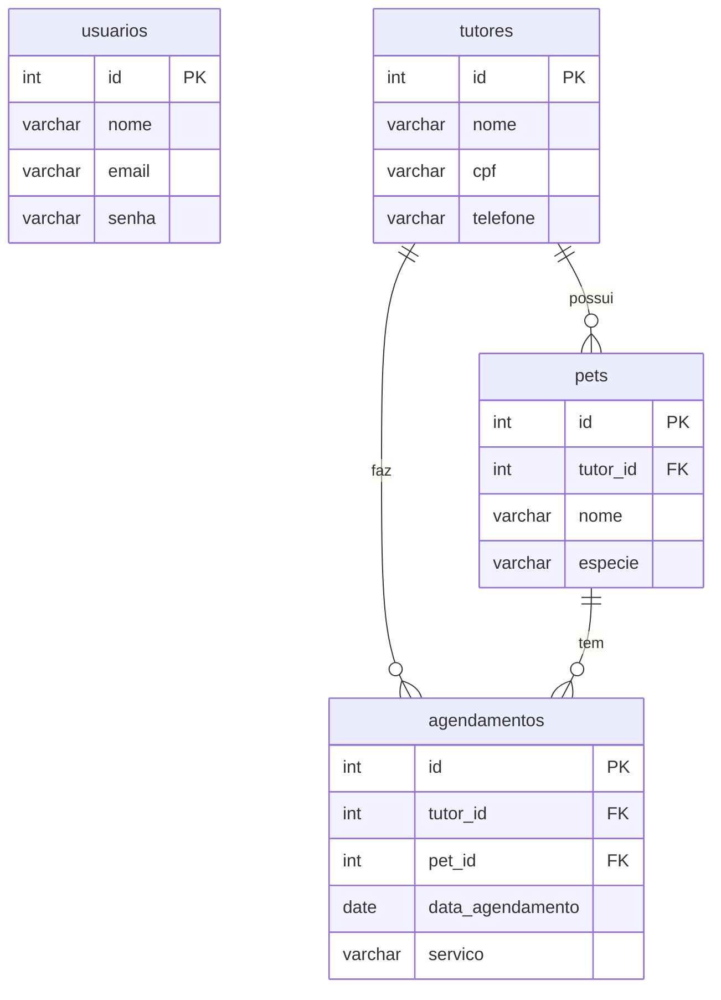

# SAEP 2026 - Documentação

Esse é um sistema web que será desenvolvido para controle de agendamentos, tutores e pets de uma clínica veterinária.

## 1. Linguagem de programação e banco de dados usados

- PHP 8.5.9, Postgre SQL; MVC simples

## 2. Requisitos do sistema

- RF-01 (login): Autenticar usuário com validação de erro e sessão com tempo de expiração.

- RF-02 (tela principal): Exibir o nome do usuário logado, menu para acessar tutor, pet e agendamento, e botão para sair.

- RF-03 (Tutores): Cadastrar tutor (com CPF criptografado), listar e buscar por termo.

- RF-04 (Pets e agendamentos): Cadastrar pet vinculado a um tutor; listar agendamentos ordenados por data e atualizar a data do agendamento.

## 3. Diagrama Entidade-Relacionamento (DER)

